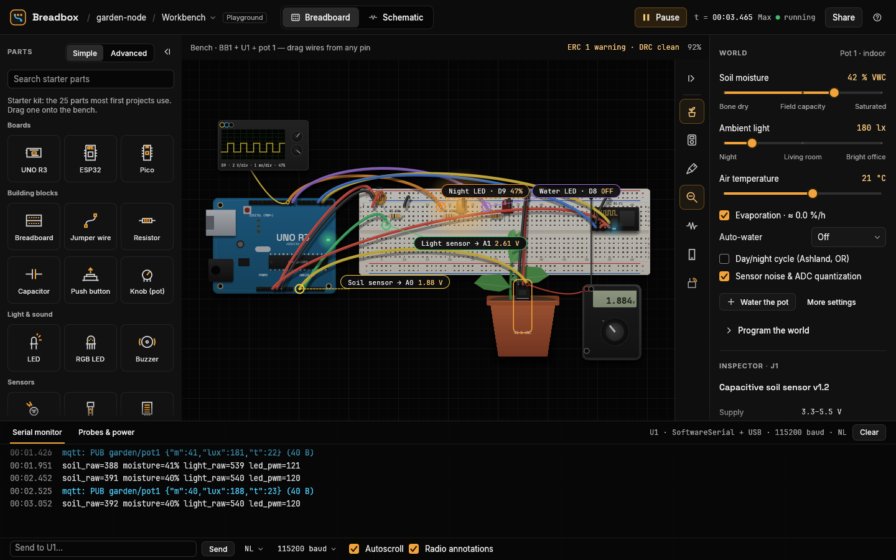
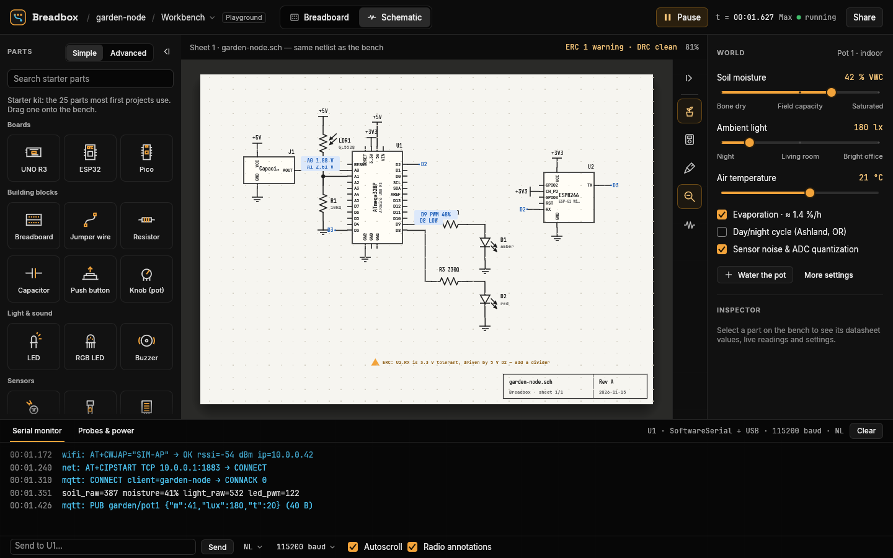
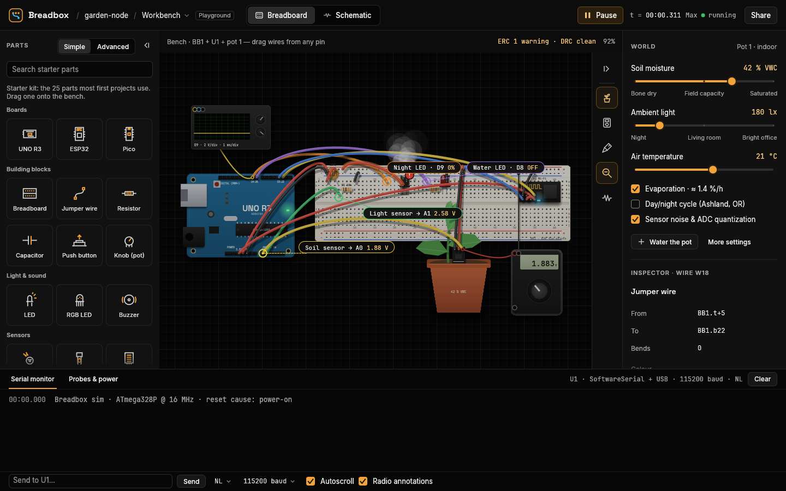
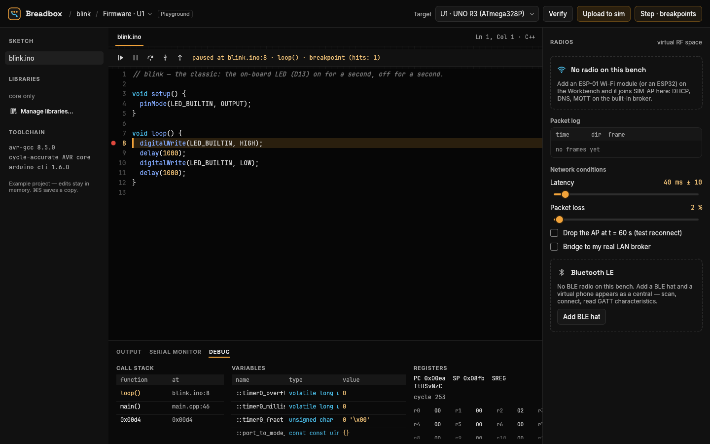
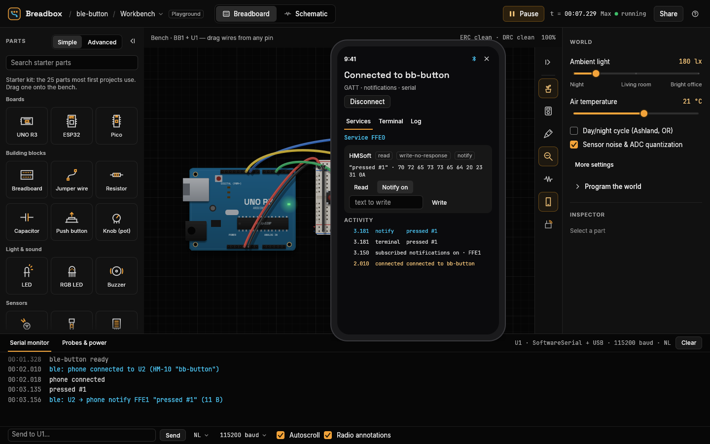
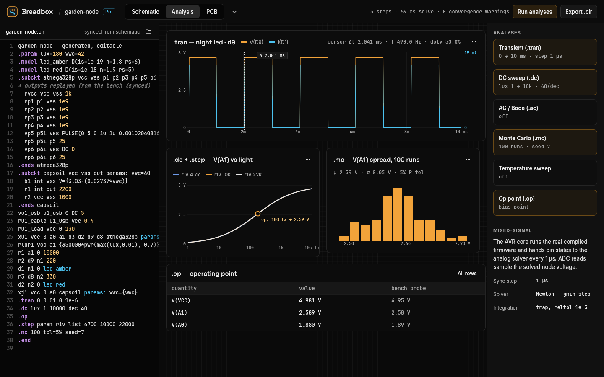
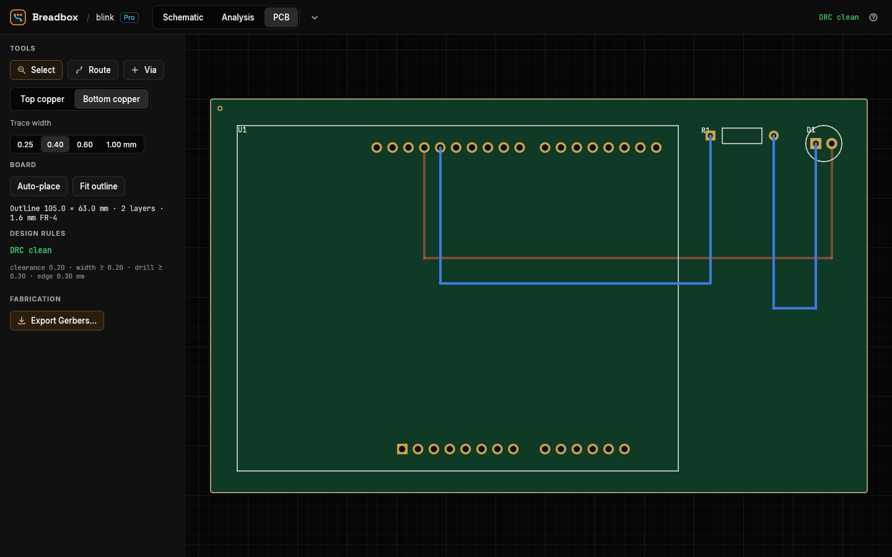
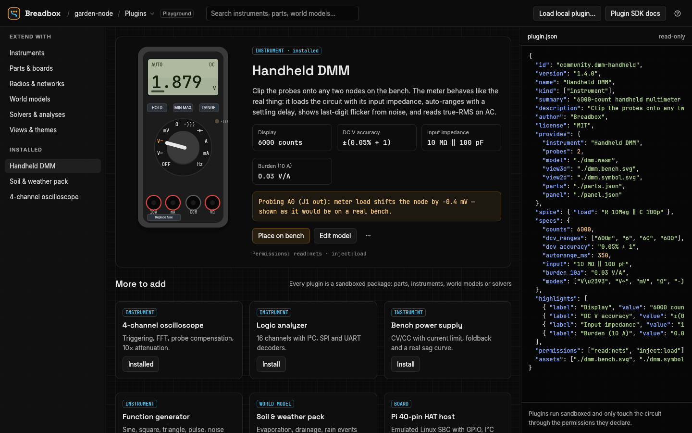

<p align="center">

</p>
<h1 align="center">Breadbox</h1>
<p align="center"><b>A very fun, very serious circuit playground.</b><br>Breadboards, real Arduino firmware, sensors in a pot of soil, radios, instruments and a SPICE workbench — one native macOS app, written in Rust.</p>
<p align="center">
<a href="https://github.com/alexwhb/breadbox/actions/workflows/ci.yml"></a>
<a href="LICENSE"></a>


</p>
<p align="center"></p>

## What is Breadbox?

Breadbox is a virtual electronics bench for hobbyists **and** a real SPICE workbench for
engineers, over **one shared circuit model**:

- **Playground** — drag parts onto a 2.5D bench and wire them with sagging jumper wires.
  Arduinos run **real compiled firmware** on a cycle-accurate AVR core; ESP32 and Pico sketches
  run against an Arduino-compatible host core. Sensors live in a simulated world (soil moisture,
  sun and lamps, temperature, a hand in front of a sonar), LEDs glow with their current — and
  let out the magic smoke when you overdo it.
- **Pro** — the same circuit as a schematic and an editable SPICE netlist: transient, DC sweep,
  AC/Bode, Monte Carlo, temperature and noise analyses, an operating-point table next to the
  live bench probes, and a two-layer PCB editor with DRC and Gerber export.

Around them: a **Firmware** screen with a source-level debugger, a virtual **Wi-Fi / MQTT /
Bluetooth / LoRa** network, **Lessons** that let you do the math before the meter answers, and
**Plugins** — sandboxed WebAssembly instruments, parts, analyses, world models and themes.

## Highlights

- **Real firmware, cycle-accurate.** Sketches compile with the real Arduino toolchain and run
  on an emulated ATmega328P / ATmega2560 (UNO, Nano, Mega) with every instruction, timer,
  USART, ADC, SPI and I²C peripheral — about 24× faster than real time.
- **A SPICE engine you can trust.** Written from scratch in Rust (sparse LU, Newton with
  convergence aids, diodes, Gummel-Poon BJTs, MOSFETs, JFETs, switches, behavioural sources),
  checked against ngspice on 47 reference circuits.
- **Mixed-signal co-simulation.** Firmware, analog circuit, behavioural devices, the world and
  the radios advance in lock-step with 1 µs sync; ADC samples land on the exact cycle.
- **82 parts** with datasheet behaviour and damage limits: LEDs, RGB, NeoPixels, LCD and OLED
  displays, servos, steppers, motors, relays, DHT22, DS18B20, BME280, HC-SR04, PIR, LDRs, soil
  sensors, op-amps, 555, 74HC logic, regulators…
- **A virtual network.** An ESP-01 that speaks real ESP-AT, a built-in MQTT broker, DHCP/DNS/NTP,
  latency and packet-loss injection, a packet log you can open in Wireshark, an optional bridge
  to your real LAN broker, BLE modules and a virtual phone, and LoRa with real airtime.
- **Instruments that behave like the real ones.** A handheld multimeter whose 10 MΩ input
  really loads the node, a 4-channel scope, a logic analyzer with UART/I²C/SPI/1-Wire decoders,
  a bench supply with current limiting, a function generator.
- **A debugger for your sketch.** Breakpoints by source line, step over/into/out, call stack,
  locals and globals from DWARF, SRAM/flash/EEPROM and I/O-register views.
- **Lessons.** 24 lessons in five tracks, with "do the math myself", hints, worked solutions,
  real measurements, and a lesson editor that saves shareable lesson packs.
- **Plugins.** Everything above can be extended with WebAssembly plugins that only touch the
  circuit through the permissions they declare.

## A quick tour

<table>
<tr><td width="50%"><br><sub><b>Breadboard and schematic</b> — one circuit, two views, live values on the nets.</sub></td><td width="50%"><br><sub><b>Fun mode physics</b> — an LED without its resistor lets out the magic smoke.</sub></td></tr>
<tr><td><br><sub><b>Firmware</b> — real avr-gcc builds, breakpoints, call stack, variables, registers.</sub></td><td><br><sub><b>Radios</b> — a virtual phone gets BLE notifications from the bench.</sub></td></tr>
<tr><td><br><sub><b>Pro</b> — transient, DC sweep + .step, Monte Carlo and .op next to the bench probes.</sub></td><td><br><sub><b>PCB</b> — place footprints, route two layers, DRC, export Gerbers.</sub></td></tr>
<tr><td><br><sub><b>Plugins</b> — a Fluke-style meter as a sandboxed WebAssembly plugin.</sub></td><td><br><sub><b>Lessons</b> — Ohm's law with a real LED, a real meter and your own math.</sub></td></tr>
</table>

## Getting started

- **New project** (Home, top right) asks for a name and a mode: **Playground** for the
  breadboard bench, **Pro** for netlists and SPICE analyses. Projects live in
  `~/Documents/Breadbox` unless you choose another folder.
- **Examples** open read-only: try anything, then **File → Save As…** to keep your changes.
  **garden-node** is the full tour — sensors in a pot of soil, two LEDs, Wi-Fi and MQTT.
- **Open project…** opens a project folder or a shared `.breadbox.zip`; **Import .cir…** opens
  a SPICE netlist as a new Pro project.
- **Lessons** teach electricity, sensors and microcontrollers step by step; **Plugins** add
  instruments, parts and world models.
- The **?** at the top right of every screen opens that screen's help page.

Useful shortcuts: ⌘R run / pause · ⌘B verify · ⌘U upload · ⌘1–5 switch screens · R rotate ·
F flip · ⌘D duplicate · ⌘Z / ⌘⇧Z undo / redo · pinch or ⌘-scroll to zoom.

## Install

There is no signed release yet — build it from source (a few minutes):

```sh
git clone https://github.com/alexwhb/breadbox.git
cd breadbox
scripts/bundle-macos.sh            # → dist/Breadbox.app (add --dmg for a disk image)
open dist/Breadbox.app
```

Or run it straight from the checkout with `cargo run --release -p breadbox`.

**Requirements**

- **macOS 14 or newer on Apple Silicon.** The code is portable Rust, but only Apple Silicon Macs
  are built and tested today.
- **[Rust via rustup](https://rustup.rs)** to build. `rust-toolchain.toml` selects stable and the
  `wasm32-unknown-unknown` target. If Homebrew also installed an older `rustc`, put
  `~/.cargo/bin` first on your `PATH`.
- **Xcode Command Line Tools** (`xcode-select --install`) — ESP32 / Pico sketches are compiled
  with the system `clang++`.
- **Nothing else to start.** Every example and lesson ships with prebuilt firmware, so Run
  works out of the box.

**The Arduino toolchain is installed by the app** the first time you press Verify: Breadbox
downloads `arduino-cli` and the `arduino:avr` core into
`~/Library/Application Support/Breadbox/toolchain` (about 150 MB) with its own settings, so your
Arduino IDE setup is never touched. An existing `arduino-cli` from `PATH` or Homebrew is reused
when it works. Libraries you install with **Manage libraries…** go to Breadbox's own
sketchbook, never `~/Documents/Arduino`.

**No Rosetta?** The `arduino:avr` core ships an Intel-only avr-gcc 7.3 and ctags. On an Apple
Silicon Mac without Rosetta, Breadbox installs native replacements instead — avr-gcc 8 from
Homebrew (`osx-cross/avr/avr-gcc@8`) and Arduino's ctags built from source — and passes them to
`arduino-cli`. That path needs Homebrew (or install Rosetta 2:
`softwareupdate --install-rosetta`).

## Plugins

A plugin is a folder (or a `.bbplugin` zip of one) with a `plugin.json` manifest and, usually, a
WebAssembly module. Plugins run in a [wasmtime](https://wasmtime.dev) sandbox with fuel, time
and memory limits, and can only touch the circuit through the permissions they declare
(`read:nets`, `inject:load`, `drive:pins`, `world:read`, `world:write`, `radio:space`,
`ui:panel`, `fs:project`, `net:lan`). The user approves them on install.

| kind | what it adds | example |
|---|---|---|
| `part` | a new component: pins, bench art, a SPICE model and/or wasm behaviour | `plugins/examples/template`, `plugins/examples/lm317` (ships a `.subckt`) |
| `instrument` | a bench instrument with a front panel, probes and controls | `plugins/dmm-handheld`, `scope-4ch`, `logic-analyzer` |
| `generator` | a custom signal source | `plugins/examples/sawtooth`, `function-generator` |
| `world-model` | new world state and physics | `plugins/soil-weather` |
| `radio` | radio modules and media | `plugins/lora-gateway` |
| `analysis` | a Pro analysis over the netlist (may call the solver) | `plugins/examples/sensitivity` |
| `board` | a declarative AVR board variant | `plugins/examples/pro-mini` |
| `theme` | colour tokens | `plugins/examples/solarized` |
| `lesson-pack` | lessons (the lesson editor saves these) | — |

First-party plugins ship with the app: **Handheld DMM**, **4-channel oscilloscope**, **Logic
analyzer**, **Bench power supply**, **Function generator**, **Soil & weather pack** and **LoRa +
virtual gateway**.

### Write your first plugin

Plugins are written against the Rust guest SDK (`crates/bb-plugin-sdk`) — or in any language that
compiles to core WebAssembly, using the documented ABI.

```toml
# my-blinker/Cargo.toml
[package]
name = "my-blinker"
version = "0.1.0"
edition = "2024"

[lib]
crate-type = ["cdylib"]

[dependencies]
bb-plugin-sdk = { git = "https://github.com/alexwhb/breadbox" }

[profile.release]
opt-level = "s"
lto = true
panic = "abort"
strip = true

[workspace]
```

```rust
// my-blinker/src/lib.rs — an LED driver chip with its own oscillator
use bb_plugin_sdk::prelude::*;

struct Blinker { out: usize, on: bool }

impl Part for Blinker {
    fn init(cfg: &Config) -> Result<Self, String> {
        Ok(Blinker { out: cfg.pin("OUT").ok_or("no OUT pin")?, on: false })
    }
    fn on_start(&mut self, ctx: &Ctx) { ctx.tick_every(0.25); }
    fn on_tick(&mut self, ctx: &Ctx) {
        self.on = !self.on;
        ctx.set_drive(self.out, Drive::Thevenin { v: if self.on { 5.0 } else { 0.0 }, r: 30.0 });
    }
}

export_part!(Blinker);
```

```sh
cp plugins/examples/template/{plugin.json,parts.json} my-blinker/   # set "id" and "name"
cd my-blinker
cargo build --release --target wasm32-unknown-unknown
cp target/wasm32-unknown-unknown/release/my_blinker.wasm blinker.wasm
```

Then **Plugins → Load local plugin…** and pick the folder: the part appears in the parts
palette, and the plugin hot-reloads whenever a file in the folder changes. Zip the folder as
`my-blinker.bbplugin` to share it.

**Docs:** [Plugin SDK & ABI](docs/PLUGIN-SDK.md) · [manifest schema](docs/plugin.schema.json) ·
[examples](plugins/examples) · [first-party plugins](plugins).

## Lessons

Five tracks ship with the app: **Electricity you can see** (8 lessons, from "What is a circuit?"
to "Your first sketch: blink"), **Sensors & the real world**, **Microcontrollers from zero**,
**Radios & IoT** and **Pro: SPICE analysis**. Steps can ask you to build, predict with your own
math, measure, experiment, break something on purpose, answer a quiz or write code — and they're
checked against the live simulation.

**Make your own:** **Lessons → Make your own lesson** captures the current bench, lets you add
steps and suggested checks, validates, and saves a lesson pack you can share as a `.bbplugin`.
By hand, a lesson is a TOML file next to a start circuit:

```toml
id = "my-first-lesson"
track = "electricity"
order = 9
title = "Two LEDs in series"

[bench]
project = "two-leds.bench.json"

[[steps]]
title = "Predict the current"
body = "Both LEDs drop about 2 V. What does the resistor see?"
```

The full format — eight step kinds, the checks, worked solutions and lesson packs — is in
[docs/LESSON-FORMAT.md](docs/LESSON-FORMAT.md).

## How it works

```
+---------------------------- breadbox (eframe / egui app) ----------------------------+
| Home | Workbench | Firmware | Pro (Analysis / Schematic / PCB) | Plugins | Lessons    |
+--------------+-----------------------------+--------------------------+--------------+
               | commands / telemetry        | netlists                 | manifests
+--------------v---------------------+  +----v-----------+   +----------v-----------+
| bb-sim: co-simulation, 1 us sync   |<>| bb-spice       |   | bb-plugin            |
| MCUs, analog, devices, world       |  | SPICE engine   |   | wasmtime sandbox     |
+---+----------+-----------+-----+---+  +----------------+   +----------------------+
    |          |           |     |
+---v----+ +---v-------+ +-v---+ +v----------+   bb-circuit: parts, bench/schematic/PCB,
| bb-avr | |bb-firmware| |world| | bb-radio  |     connectivity, netlister, ERC/DRC
| AVR    | |toolchain, | |soil,| | Wi-Fi,    |   bb-lessons: lesson format + checkers
| core   | |DWARF, host| |sun  | | MQTT, BLE |   bb-core: time, units, device contract
+--------+ +-----------+ +-----+ +-----------+
```

| crate | what it is |
|---|---|
| `bb-core` | shared types: picosecond sim time, SI units, the `Device` contract, resource paths |
| `bb-spice` | the analog engine: parser, MNA, device models, analyses, incremental co-sim sessions |
| `bb-avr` | cycle-accurate ATmega328P / ATmega2560 emulator with debug hooks |
| `bb-firmware` | arduino-cli management and compiles, ELF/DWARF debug info, the ESP32/Pico host core |
| `bb-circuit` | the document model: parts library, bench / schematic / PCB, netlister, ERC/DRC, undo |
| `bb-world` | soil, light and sun, air, objects, keyframes and world scripts |
| `bb-radio` | the virtual RF space: ESP-AT, TCP/IP services, MQTT broker, BLE, LoRa, packet log |
| `bb-sim` | the co-simulation engine and the threaded `SimHandle` the app talks to |
| `bb-plugin` / `bb-plugin-sdk` | plugin host (manifests, registry, sandbox) and the guest SDK |
| `bb-lessons` | lesson format, checkers, progress, the lesson-editor model |
| `breadbox` | the app: screens, bench and schematic canvases, widgets, macOS integration |

**Accuracy and speed** (Apple Silicon, release build — all enforced by `scripts/test-all.sh`):

| | |
|---|---|
| SPICE vs ngspice, 47 reference circuits | `.op`/`.dc` within 0.1 %, `.ac` within 0.5 % / 0.5°, `.tran` within 1 % RMS |
| 1 024-node operating point | ~13 ms |
| busy ATmega328P sketch | ~24× real time |
| garden-node (UNO + Wi-Fi + sensors + LEDs + instruments) | ~16× real time, holds 1× with the GUI |
| Workbench frame with the bench running | < 1 ms |
| launch → first frame | ~0.25 s |

More detail: [docs/ARCHITECTURE.md](docs/ARCHITECTURE.md) · the definition of done:
[SPEC.md](SPEC.md) and its audit [docs/SPEC-AUDIT.md](docs/SPEC-AUDIT.md) ·
[docs/DESIGN.md](docs/DESIGN.md) (visual tokens) · [docs/UI-TEXT.md](docs/UI-TEXT.md).

## Build, run, test

```sh
cargo run --release -p breadbox                                        # the app
cargo run --release -p breadbox -- --smoke garden-node --seconds 5    # start-up + run check
scripts/test-all.sh                                                    # everything
```

`scripts/test-all.sh` runs formatting, clippy, ~750 unit and integration tests, the SPICE
reference suite, 36 headless end-to-end scenarios (real firmware on the full bench, MQTT,
BLE, lessons, plugins, `.cir` export through ngspice), GUI tests that drive the real screens
with `egui_kittest`, the plugin reproducibility check, the performance gates and the app-bundle
check. It skips gracefully when optional tools (ngspice, arduino-cli) are missing.

Other scripts: `scripts/build-plugins.sh` rebuilds the first-party plugins (the `.wasm` files are
committed and rebuild byte-identically); `scripts/build-test-firmware.sh` and
`lessons/build-firmware.sh` rebuild the prebuilt firmware; `scripts/check-bundle.sh` proves the
app bundle is self-contained.

## Project layout

```
crates/        the Rust workspace (see the table above)
plugins/       first-party plugins and SDK examples (a separate wasm32 workspace)
lessons/       five lesson tracks (TOML + start benches + prebuilt firmware)
examples/      example projects, with prebuilt firmware in examples/fixtures
tests/e2e/     headless end-to-end scenarios
scripts/       test-all, bundle-macos, check-bundle, build-plugins, build-test-firmware
docs/          architecture, plugin SDK, lesson format, per-screen help, design references
```

## Roadmap

Not in this version: cycle-accurate ESP32 / RP2040 cores (they run at the Arduino-API level
today), an emulated Raspberry Pi "HAT host", true 3D rendering, Windows and Linux builds, and a
signed, notarized download. Ideas and pull requests are welcome.

## Contributing

Contributions are very welcome — new parts, plugins, lessons, examples and bug fixes especially.
Read [CONTRIBUTING.md](CONTRIBUTING.md) to get set up, and please follow the
[code of conduct](CODE_OF_CONDUCT.md). Security issues (for example a plugin escaping its
sandbox): see [SECURITY.md](SECURITY.md).

## License

Breadbox is released under the [MIT License](LICENSE).

The bundled fonts — [Inter](https://rsms.me/inter/),
[JetBrains Mono](https://www.jetbrains.com/lp/mono/) and
[Space Grotesk](https://github.com/floriankarsten/space-grotesk) — are under the SIL Open Font
License 1.1 (`assets/fonts/*-OFL.txt`). The Arduino toolchain is not bundled: `arduino-cli`,
the `arduino:avr` core and avr-gcc are downloaded on demand under their own licenses.
[ngspice](https://ngspice.sourceforge.io) generated the SPICE reference data and is not shipped.
The app bundle lists every linked Rust crate and its license in
`Contents/Resources/licenses/THIRD-PARTY.md`.
