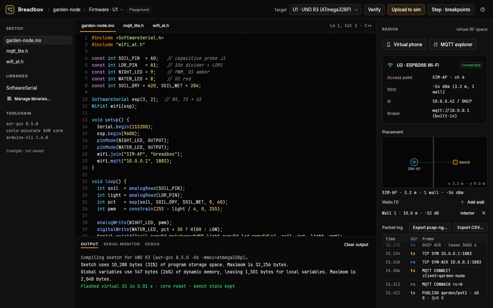
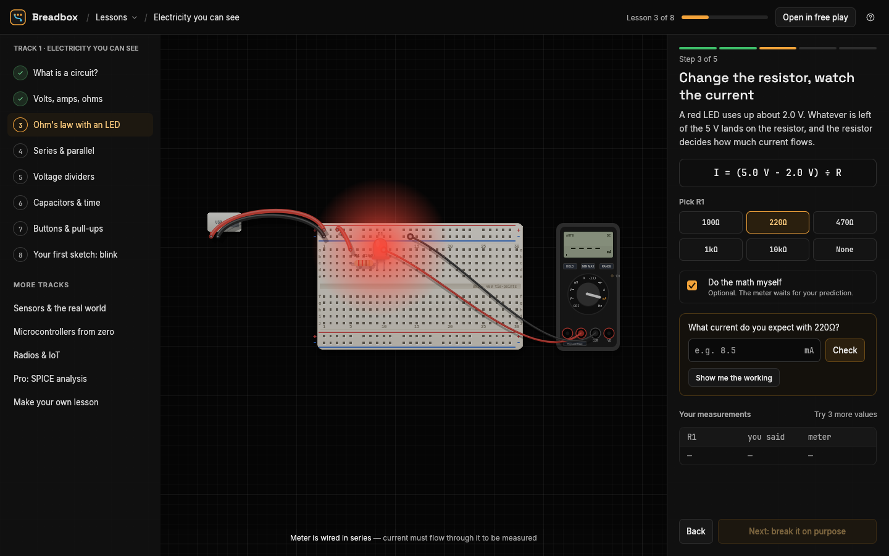

# Breadbox

**A very fun, very serious circuit playground** — a native macOS app, written in Rust, that is
both a virtual electronics bench for hobbyists and a real SPICE workbench for engineers.


## What it is

Breadbox has two modes over **one shared circuit model**:

- **Playground** — breadboards and jumper wires on a 2.5D bench. Arduinos run *real compiled
  firmware* on a cycle-accurate AVR core; ESP32 and Pico sketches run against an
  Arduino-compatible host core. Sensors sit in a pot of soil under a day/night sky, LEDs glow
  with their current (and pop when you overdo it), radios talk to a virtual Wi-Fi / MQTT / BLE
  network, and instruments behave like the real ones.
- **Pro** — the same circuit as a schematic and a SPICE netlist: transient, DC sweep, AC/Bode,
  Monte Carlo, temperature and noise analyses, an operating-point table next to the live bench
  probes, and a two-layer PCB editor with DRC and Gerber export.

Around them: a **Firmware** screen (editor, Verify / Upload, library manager, a source-level
debugger with breakpoints and variables), **Lessons** that let you do the math yourself before
the meter tells you, and **Plugins** — sandboxed WebAssembly instruments, parts, analyses,
themes and lesson packs.







## Requirements

- **macOS 14 or newer, Apple Silicon.** (The code is portable Rust; only Apple Silicon Macs are
  built and tested.)
- **Xcode Command Line Tools** (`xcode-select --install`) for ESP32 / Pico boards: their
  sketches are compiled with the system `clang++` against Breadbox's host core.
- **Nothing else to start.** Every example and lesson ships with prebuilt firmware, so Run
  works out of the box.
- **The Arduino toolchain is installed by the app** the first time you press Verify (or
  Install toolchain on the Firmware screen): Breadbox downloads `arduino-cli` and the
  `arduino:avr` core into `~/Library/Application Support/Breadbox/toolchain` (about 150 MB)
  with its own config, so your Arduino IDE setup is never touched. An existing `arduino-cli`
  on `PATH` or from Homebrew is used if it works.

**No Rosetta? No problem.** The `arduino:avr` core ships an Intel-only avr-gcc 7.3.0 and ctags,
which cannot run on an Apple Silicon Mac without Rosetta. Breadbox detects that and installs
native replacements instead: avr-gcc 8 from Homebrew (`osx-cross/avr/avr-gcc@8`) and Arduino's
ctags built from source into the toolchain folder, then passes them to `arduino-cli` as build
properties. You need Homebrew for that path (or install Rosetta 2:
`softwareupdate --install-rosetta`).

## Build, run, test

Use the rustup toolchain (put `~/.cargo/bin` first on `PATH`; an older Homebrew rustc may also
be installed):

```sh
export PATH="$HOME/.cargo/bin:$PATH"
cargo run --release -p breadbox                 # the app
cargo run --release -p breadbox -- --smoke garden-node --seconds 5   # start-up + run check
cargo test -p breadbox                          # unit + GUI tests (egui_kittest, wgpu)
scripts/test-all.sh                             # everything: fmt, clippy, unit, SPICE
                                                # reference, e2e, GUI, perf
```

`scripts/build-plugins.sh` rebuilds the first-party plugins to wasm (the `.wasm` files are
committed); `scripts/build-test-firmware.sh` and `lessons/build-firmware.sh` rebuild the
prebuilt firmware with `arduino-cli`.

## Make the app

```sh
scripts/bundle-macos.sh          # → dist/Breadbox.app (release, ad-hoc signed)
scripts/bundle-macos.sh --dmg    # … and dist/Breadbox.dmg
scripts/check-bundle.sh          # prove it is self-contained (see below)
```

The bundle carries everything it loads in `Contents/Resources`: example projects with
prebuilt firmware, the lessons, the first-party plugins (+ the plugin SDK and examples), the
docs, the fonts with their licences, the ESP32/Pico host core, and third-party notices. User
data never goes into the bundle:

| what | where |
|---|---|
| your projects | `~/Documents/Breadbox` (examples open read-only; Save makes a copy) |
| installed plugins, lesson progress, toolchain, window state | `~/Library/Application Support/Breadbox` |
| build cache, staging | `~/Library/Caches/Breadbox` |

`scripts/check-bundle.sh` copies the app out of the checkout and runs it under `sandbox-exec`
with the checkout denied: garden-node, a lesson bench, the Handheld DMM plugin placed on a
bench, an ESP32 example compiled against the bundled host core, and a real window; then it
opens the app, times the first frame (< 2 s) and quits it.

## Project layout

```
crates/
  bb-core       shared types: time, SI units, the device contract, resource/user-data paths
  bb-spice      the analog engine (parser, MNA, models, analyses)
  bb-avr        cycle-accurate ATmega328P / 2560 emulator
  bb-firmware   arduino-cli install + compile, ELF/DWARF, ESP32/Pico host core
  bb-circuit    the document model: parts library, bench/schematic/PCB, netlister, ERC/DRC
  bb-world      soil, light, temperature, objects
  bb-radio      virtual Wi-Fi / MQTT / BLE / LoRa space
  bb-sim        co-simulation engine (MCUs + analog + devices + world + radios)
  bb-plugin     plugin manifests, registry, wasmtime sandbox
  bb-plugin-sdk the guest SDK plugins build against (wasm32)
  bb-lessons    lesson format, checkers, progress, the lesson editor model
  breadbox      the eframe/egui app
plugins/        first-party plugins + SDK examples
lessons/        five lesson tracks
examples/       example projects (+ prebuilt firmware in examples/fixtures)
tests/e2e/      headless end-to-end scenarios
scripts/        test-all, bundle-macos, check-bundle, build-plugins, build-test-firmware
```

Read more: [SPEC.md](SPEC.md) (the definition of done) ·
[docs/ARCHITECTURE.md](docs/ARCHITECTURE.md) · [docs/DESIGN.md](docs/DESIGN.md) ·
[docs/PLUGIN-SDK.md](docs/PLUGIN-SDK.md) · [docs/LESSON-FORMAT.md](docs/LESSON-FORMAT.md).
In the app, **Help** shows the guide, the plugin SDK and the lesson format.

## Write your first plugin

A plugin is a folder with a `plugin.json` and (usually) a WebAssembly module. Start from the
template, a "blinker" chip:

```sh
cp -r plugins/examples/template my-blinker      # set "id" and "name" in plugin.json
cd my-blinker
cargo build --release --target wasm32-unknown-unknown
cp target/wasm32-unknown-unknown/release/*.wasm blinker.wasm
```

```rust
use bb_plugin_sdk::prelude::*;
struct Blinker { out: usize, on: bool }
impl Part for Blinker {
    fn init(cfg: &Config) -> Result<Self, String> {
        Ok(Blinker { out: cfg.part.as_ref().and_then(|p| p.pin("OUT")).ok_or("no OUT")?, on: false })
    }
    fn on_start(&mut self, ctx: &Ctx) { ctx.tick_every(0.25); }
    fn on_tick(&mut self, ctx: &Ctx) {
        self.on = !self.on;
        ctx.set_drive(self.out, Drive::Thevenin { v: if self.on { 5.0 } else { 0.0 }, r: 30.0 });
    }
}
export_part!(Blinker);
```

Then **Plugins → Load local plugin…** and pick the folder: the part appears in the parts
palette, and the plugin hot-reloads whenever a file in the folder changes. Zip the folder as
`name.bbplugin` to share it. Instruments, analyses, themes and boards work the same way — see
[docs/PLUGIN-SDK.md](docs/PLUGIN-SDK.md) (the app bundle also carries the SDK and the
examples in `Breadbox.app/Contents/Resources`).

## Make your own lesson

In the app: **Lessons → Make your own lesson**. Capture the current bench (any Workbench
project or the open lesson), add steps (explain, pick a value, predict with the math,
measure, quiz, code), let Breadbox suggest the checks for a part or two pins, Validate, and
Save lesson pack — it is a plugin (`kind: lesson-pack`) that shows up in Lessons right away
and can be shared as a `.bbplugin`.

By hand, a lesson is a TOML file next to a start circuit:

```toml
id = "my-first-lesson"
track = "electricity"
order = 9
title = "Two LEDs in series"

[bench]
project = "two-leds.bench.json"

[[steps]]
title = "Predict the current"
body = "Both LEDs drop about 2 V. What does the resistor see?"
```

The full format — eight step kinds, the checks, worked solutions and lesson packs — is in
[docs/LESSON-FORMAT.md](docs/LESSON-FORMAT.md).

## License

MIT OR Apache-2.0. Bundled fonts (Inter, JetBrains Mono, Space Grotesk) are under the SIL Open
Font License 1.1 (`assets/fonts/*-OFL.txt`).
